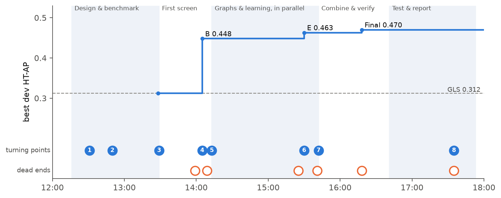

# How we got here

**The main point:** the final method is the sum of three findings made in about six hours on 27 October 2026.
1. **Clean the profiles before comparing them.** Whitening came from the literature (GLS). Standardising genes first was the agents' own addition, and it turned out to be the most useful change to the first-order score.
2. **Ask whether two genes share partners.** This was planned from the literature, pushed up the priority list by an early look at the labels that should not have happened, and confirmed as the largest gain in the first screen.
3. **Add a graph embedding and average the views.** This came last, after a verification showed that the shared-partner score helped only large complexes, and after every attempt to learn from labels failed.

The work was done by a principal-investigator agent (the "PI", Claude Opus 5.5) and 25 sub-agents it briefed (18 Claude Opus 5.5, 7 Claude Sonnet 5.5). Humans wrote the task prompt, supplied the data and sent one message, "continue", during the research. All times below are from the session record and git commits (UTC, which was also local time).

<!-- widget:timeline -->

*Best development score over the day (5-seed means, plotted when each view was first found), the eight turning points (filled) and the main dead ends (open). The grey dashed line is GLS. In the interactive page, click a marker to open that turning point.*

## The setting in one paragraph

The prompt asked for a co-essentiality method that predicts co-complex membership, optimises AUPRC, "clearly beats" Pearson, Spearman and GLS, and uses leakage-aware splits. It required a literature review, a design document reviewed up to three times, a research log and independent verification. The official hu.MAP test set was withheld. Words used below: **dev** is the development data used for every choice (190 clusters of complexes, cross-validated); the **internal final test** is the 57 clusters set aside and scored once; **macro AP** (per-complex AP) is AP averaged complex by complex, so that small complexes count as much as large ones.

## 1. The starting plan: whitening and shared partners (12:16–12:31)

**Situation.** Before touching the data, the PI needed a design. It launched a literature agent and an infrastructure agent in parallel.

**Options on the table.** The literature review (LITERATURE.md) listed 13 ideas. The two that matter here:
- *Whitening* by the cell-line covariance, the core of GLS [Wainberg 2021], reported by Gheorghe & Hart (2022) as the largest single gain among normalisation choices.
- *Second-order similarity*: compare two genes' whole similarity rows or their shared top neighbours, because "complex members share partners" (LITERATURE.md §6.1, idea 4, rated medium–high benefit).

**Decision.** The PI's first design put both on the plan: a family of whitening filters that includes GLS as a special case (remove k components, add a ridge), and sparse second-order scores. Ensembles were planned as rank averages. Gene standardisation, graph embeddings and z-score averaging were *not* in this first plan.

**What it produced.** The skeleton of [Step 1](METHOD.md#step1) and the idea behind [Step 3](METHOD.md#step3).

*Where:* LITERATURE.md §6.1; first design written at 12:31 (session transcript; never committed); DESIGN.md §4.

## 2. An early look at the labels sets the priorities (12:32–13:05)

**Situation.** Six reviewer agents critiqued the first design. Their briefs did not forbid computing metrics, and two of them (algorithms, data) scored label-free variants against *all* labelled pairs, including pairs that would later form the internal final test.

**What their probes showed** (pooled AP, all pairs):

| Score | AP |
|---|---|
| GLS | 0.255 |
| Whitening with a shrunk covariance | 0.299–0.301 |
| Second order, all partners | 0.205 |
| Second order, top 1% of partners only | 0.310, "the strongest single layer" |
| Average of first- and second-order z-scores | 0.314 |
| Same, averaging ranks instead | 0.263 |

**Decision.** The PI logged this as contamination of the future test set ("logging as contamination; adding process rule") and wrote the rule that non-evaluating agents get no access to label metrics. But it also passed these numbers to the round-2 reviewers, whose recommendation, that a z-averaged label-free ensemble be the default final candidate, went into the design.

**Why it matters.** These probes shaped which families were tried first: sparse rather than dense second order, z-averaging rather than rank averaging, shrunk whitening. All concrete settings (standardisation, 20 components, ridge 0.1, 44 partners, 512 dimensions) were chosen later on dev data only. The project disclosed this exposure ("look 0" in the test log), but its own decision note mentions only the whitening prior; this page reads the record as showing a broader influence.

**What it produced.** Priorities for [Step 3](METHOD.md#step3) (keep only the top partners) and [Step 5](METHOD.md#step5) (average z-scores, not ranks).

*Where:* `reviews/round1/algorithms_compute.md` §0; transcript 12:37 and 12:59 (round-2 brief); RESEARCH_TREE.md decision D1; `results/ift_looks.jsonl` look 0.

## 3. Deciding what "better" means (12:36–13:29)

**Situation.** hu.MAP negatives cover nearly every other pair among the same proteins, so random pair splits leak protein identity. Positives are also clumped: one connected group of 144 proteins holds about 26% of them.

**Options considered.**
- *Grouping.* Random pairs (leaky), connected components (one giant fold), or components with the giant one split into communities (chosen: 247 clusters).
- *Weighting.* Grouping by cluster leaves too many within-cluster pairs in each test fold (positive rate 1.8–9% instead of 0.53%). Round 1 proposed reweighting negatives uniformly. Round 2 pointed out that this still over-weights the hardest negatives (same-cluster pairs) 4–5 times, and proposed Horvitz–Thompson weights (inverse probability of a pair being in the fold). The PI adopted this and sent it to the infrastructure agent while it was still working.
- *The pass rule for the internal test.* A power simulation showed the 57-cluster test behaves like about 8 independent clusters; a rule requiring its confidence interval to exclude zero would pass at most 22% of the time even with a true 20% gain. Before any look, the PI moved the interval requirement to the pooled dev predictions and kept a ≥10% gain requirement on the test (design v3.1).

**Outcome.** The evaluation was frozen before any method was built: HT-weighted AP, five-fold cross-validation grouped by cluster, five seeds, a cluster bootstrap, macro AP and AP without the largest clusters as guard-rails, and two candidates at most for one test look. In hindsight the power amendment did not change the result: the final score's test interval against GLS also excluded zero.

**What it produced.** No step of the method directly, but the guard-rails exposed the weakness in [turning point 5](#tp5). A round-2 reviewer's point that per-batch standardisation breaks reproducibility led to computing z-score references once, from random genome-wide pairs ([Step 5](METHOD.md#step5)).

*Where:* DESIGN.md §3 and revision log; `reviews/round2/pi_statistics.md`; transcript 13:04 ("adopting; forwarding to infra") and 13:29; commits 1155d55, 47dd58b, d94db6f.

## 4. The first screen: standardise genes, then count shared partners (13:05–14:05)

**Situation.** A layer-building agent computed 128 label-free scores genome-wide; a screening agent scored them on dev. The PI's brief to the layer builder added one item not found in the literature review or any review: "optional per-gene standardisation".

**Evidence** (dev, seed 0):
- Standardising genes before estimating the covariance lifted the whitened scores from about 0.30 to 0.36. After that, results were flat across the number of removed components (0–20) and the ridge strength (0.01–0.3). Unregularised GLS-like whitening was the worst whitened setting (0.279); removing 40 components hurt.
- The shared-partner score added +0.036, and comparing it against each gene's own background (row z-score) another +0.034. Fewer partners were better, down to about 0.25% of genes.
- The best layer, which became **B**, scored 0.435 against 0.288 for GLS.

**A caveat the record makes clear.** B was not in the first, pre-planned grid: the standardised base and the 0.25% setting came from a second, dev-guided round. This is one reason dev numbers are optimistic. Also, the 20 removed components that the method keeps barely matter for the first-order score (+0.004); they help B slightly (0.401 vs 0.389).

**Decision.** "Key finding … Needs independent verification before I rely on it." The PI launched an independent re-implementation and, at the same moment, a graph-methods agent as the "natural next step from second-order success".

**What it produced.** [Step 1](METHOD.md#step1) as it stands (standardise, ridge), [Step 2](METHOD.md#step2) and [Step 3](METHOD.md#step3).

*Where:* `results/phaseA/README.md`; `results/layers/screen_v2.manifest.json`; transcript 13:05 and 14:05; commits 920b8c0, 34be32c, 7bd4c4b.

## 5. The ensemble fails and the gain turns out to be lopsided (13:49–14:13)

**Situation.** The design said a z-averaged ensemble should be the default final candidate. The screening agent built one by greedy forward selection.

**Evidence.**
- *The ensemble was selection noise.* Greedy selection added to B a layer that scored only 0.250 on its own. In nested cross-validation (choose on four folds, test on the fifth) the ensemble scored 0.428, exactly the same as the best single layer. Nearly 300 of the project's 822 trials went into this.
- *B's gain was concentrated.* The verifier, asked explicitly whether the gain came from a few clusters, reproduced B exactly from the raw file and found that the 10 largest clusters held 64% of the positive pairs scored. Without them, B's gain over GLS fell from +0.155 to +0.039 (interval including zero), and its macro AP equalled GLS (0.326 vs 0.325).

**Decision.** B became the provisional best, and "gain comes from a few clusters" became a standard check for every later headline result. The PI's response to the small-complex weakness was a time-boxed supervised attempt "targeting smaller complexes" ([turning point 7](#tp7)). The graph work that eventually helped small complexes had already been launched six minutes earlier for a different reason.

**What it produced.** The reason for [Step 4](METHOD.md#step4) and [Step 5](METHOD.md#step5) to exist, and the lesson that ensemble members must be pre-specified, not greedily picked.

*Where:* `results/phaseA/ENSEMBLE.md`; `results/verify/README.md`; transcript 14:13; commit a2f8622.

## 6. A graph embedding sees what shared partners miss (14:06–15:30)

**Situation.** The graph agent tried 69 ways to go beyond direct partner overlap on the same neighbour network: topological overlap, soft thresholds, diffusion (random walks, heat kernel) and spectral embeddings. The embedding idea came from the PI's brief, not from the literature review or a reviewer.

**Evidence.**
- The 512-dimensional Laplacian eigenmap (E) scored 0.463 (5 seeds) against 0.448 for B, but the difference's interval included zero, so by the pre-set rule it could not replace B.
- Its macro AP was clearly higher: 0.394 against 0.341 on seed 0 (0.406 vs 0.351 over five seeds). It did better on small complexes.
- Dimensions mattered (32: 0.321; 128: 0.429; 512: 0.460; 1,024: 0.451); topological overlap and long random walks did not help.

**Decision.** "Complementary view": E was kept as a candidate member of an average rather than as a replacement.

**What it produced.** [Step 4](METHOD.md#step4).

*Where:* `results/phaseA_graph/README.md`; transcript 15:30; commits 3bd38a6, ea7c7f5.

## 7. Learning from labels fails three times, and brings back the simple score (13:34–16:18)

**Situation.** The prompt invited any method, and the design planned supervised models as the main route. Three families were tried:
- **Stacking v1** (13:34–14:09): gradient-boosted trees and logistic regression over 12 pre-chosen similarity scores, with gene-level features. Trees 0.383 vs a plain average of the same scores 0.357; the difference +0.006 had an interval spanning zero.
- **Metric learning** (14:13–15:42): learn cell-line weights or low-dimensional projections from labelled pairs. Every version stayed within ±0.003 of its starting point. Training loss fell from 0.57 to 0.09 while validation AP did not move: the models memorised about 650 training genes.
- **Stacking v2** (15:46–16:18): logistic regression and trees over seven frozen views. 0.462 and 0.466, against 0.470 for the plain average; worse or equal in 72 of 80 seed-by-model comparisons.

**The useful side finding.** Metric learning was started to help small complexes. It did not, but its baseline row showed that the *plain first-order score* F matched B outside the 10 largest clusters and had higher macro AP (0.371 vs 0.341). The PI recorded this as "complementary to second-order".

**What it taught.** With about 2,000 training positives per fold in about 150 clusters, labels did not transfer to unseen complexes beyond what label-free geometry already captured. Gene-level features carried only a weak, general signal (essential genes are more often in complexes).

**What it produced.** The decision that the final method is label-free with equal weights ([Step 5](METHOD.md#step5)), and F's place in it ([Step 1](METHOD.md#step1)).

*Where:* `results/phaseB/`, `results/phaseC/README.md`, `results/phaseB_v2/README.md`; transcript 15:42; commits b3480c2, 26623ab, e242a7c.

## 8. A rule written before the result, and one look at the test (15:42–17:36)

**Situation.** By 15:42 there were three views with different strengths: B (best overall), E and F (better on small complexes). The original idea of a z-averaged ensemble, which had failed when its members were redundant, now had complementary members.

**Options considered.** The PI wrote four equal-weight averages by hand (B+E, B+F, B+E+F, B+E+F+heat diffusion) alongside the learned stackers, and before running them wrote decision rule D3: the best combination replaces B as the primary test candidate only if its gain over B has a confidence interval above zero in at least 3 of 5 seeds *and* its macro AP is not lower; otherwise B is primary.

**Evidence.**
- B+E+F scored 0.470 (macro 0.395) against B's 0.448 (0.351); its gain over B had an interval above zero in all five seeds. B+E+F+diffusion tied (0.469) at twice the runtime.
- Nested selection among the four averages gave 0.468, so choosing among them added little optimism.
- A second verifier rebuilt everything, including the eigenmap, independently and matched to 2.6e-5. It also found the margin over B fragile: with 256 dimensions instead of 512, the interval stayed above zero in only 2 of 5 seeds.
- **The one look** (17:35), with the command fixed in advance: final score 0.345, B 0.317, GLS 0.242, Spearman 0.146, Pearson 0.134. The final score passed against all three baselines. B, the backup, would have failed: its macro AP was 0.296 against 0.369 for GLS. A third verifier re-derived every test number with its own code.

**What it produced.** The final method ([Step 5](METHOD.md#step5)). The test showed that combining views protected against B's small-complex weakness: the final score tied GLS on macro AP (0.365 vs 0.369), where B fell far behind. It did not show that the method beats GLS on small complexes.

*Where:* RESEARCH_TREE.md decisions D3–D4; `results/phaseB_v2/decision.json`; `results/ift/look01_2026-10-27.json`; commits e884f44, e242a7c, 460fd36, 8267142, b914a8e.

## The research process

**Who did what.**
- **The PI agent** wrote the design and all decision notes, briefed every sub-agent, forwarded reviewers' changes to running agents, fixed one reproducibility bug itself, chose the combinations to test, wrote the pre-specified rule and ran the single test look. It read sub-agents' summaries, not their raw logs.
- **Sub-agents** wrote all the code and ran all the experiments: literature (1), infrastructure (2), design reviewers (8), method scientists (6), engineering (3), independent verifiers (3) and retrospectives (2).
- **Humans** gave the prompt and the data, and typed "continue" once (15:28). That message ended a 17-minute pause in which the PI was waiting with no work blocked; the next result arrived two minutes later, so it did not change the method. A few questions after the final report (for example, what the method is called) had no effect on it.

**Where exploration was productive.**
- Computing all label-free scores genome-wide once and caching them made each screen fast (148 scores evaluated in about 4 minutes).
- Independent verifiers changed conclusions twice: they exposed B's concentration in large clusters, and the fragility of the final score's margin over B.
- Writing the decision rule before running the final combination round, and allowing one test look, kept the end-game clean.

**Where it went in circles.**
- *Supervised learning was run to completion three times* after the first null result. Metric learning was null by about 14:46 but ran its full ladder until 15:42. It ran in parallel with the graph work, so it cost little time on the critical path, and it produced the F side finding.
- *A greedy ensemble* used about 300 of 822 trials for a null result.
- *Idle waiting.* 104 of the PI's 175 messages in the research session were one-word "Waiting." replies to progress notifications. The largest stall was about 40 minutes when the final-evaluation agent's test suite hung (two numerical libraries deadlocked in one process); the PI waited from 16:41 to 17:35.
- *Concurrency side effects.* Agents working in the same folder left untracked files that defeated the "refuse to run on uncommitted code" guard; several runs used the override flag (recorded in their run records).

**Where human input changed direction.** During the research, it did not. The direction changes all came from agents: the round-2 statistics reviewer (weighting), the power simulation (pass rule), the verifier (concentration in large clusters) and the graph agent (complementary embedding). After the research, humans asked for the manuscript and the public repository; that phase added post-hoc analyses (a component-removed Pearson reference and controls on the final score) but did not change the method.

## Appendix: dead ends not covered above

| Tried | Result | Lesson |
|---|---|---|
| Olfactory-receptor correction for GLS (Wainberg/Boyle) | Lowered GLS (0.234 vs 0.255, all pairs) | Not used for the baseline |
| Two-sided (absolute) scores | Worse than signed for every baseline | Anti-correlation does not indicate co-complex membership |
| Restricting to Avana-screened cell lines; per-library gene effects | Per-library effects worse (0.149 vs 0.204 Pearson). Avana-flagged lines (1,048) tied with all lines; Avana-only lines (827) worse. A later check with the final method agreed: tie, and −0.039 [−0.063, −0.018] on matched pairs ([results](../../results/library_subsets/README.md)) | Library purity buys nothing once the profiles are cleaned; fewer lines cost |
| Regressing out screen-quality and lineage covariates | ≤ +0.01 over component removal | Components already capture this |
| Mutual rank, balanced mutual rank on first-order scores | ±0.01 of row z-score; no gain on the standardised base | Balancing helps weak scores, not the cleaned F |
| Jaccard (unweighted) partner overlap | 0.04–0.11 lower than weighted cosine | Link strength matters |
| Topological overlap, soft thresholds, long random walks | 0.32–0.43 vs 0.435 for B; three-step walks 0.347 | Over-smoothing |
| Heat-kernel diffusion (H) | +0.007 to +0.017 over B; in the average, a tie at twice the cost | Dropped for cost |
| Chromosome-position features | At chance (0.009) | Nuisance only |
| Gene-level essentiality features | 0.024 alone (2.6× chance); no gain added to similarity | Weak, general signal; leakage risk |
| Learned-model label-shuffle control with monotone constraints | 0.145 instead of chance | The constraint itself encodes "similar = likely"; control redesigned |
| Pearson after removing 20 components (added later, at a manuscript reviewer's request) | Dev 0.363, test 0.267 (post-hoc) | A strong simple reference, below the final score |

Full tables: [`manuscript/S2_Text.md`](../../manuscript/S2_Text.md).
