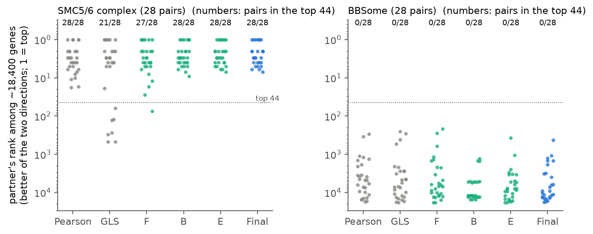
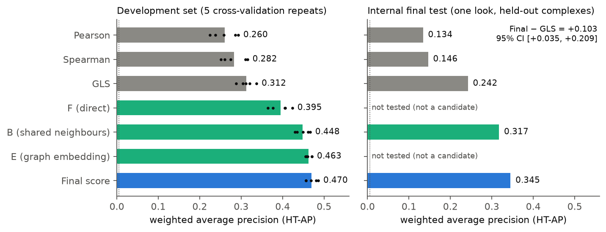
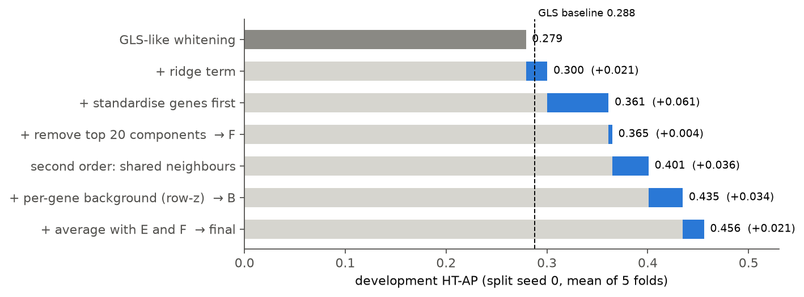
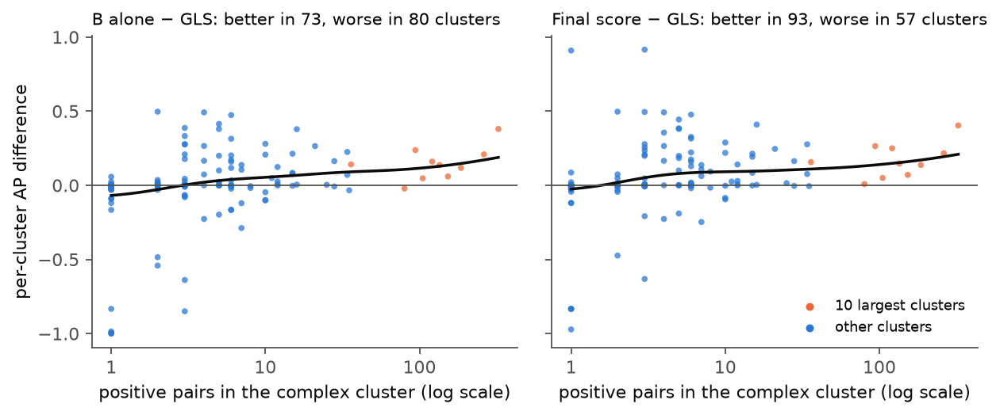

# The method: scoring protein pairs by shared genetic dependencies

**In one sentence:** the method takes the DepMap CRISPR gene-effect matrix (1,361 cancer cell lines × 18,434 genes) and gives every pair of genes a score that ranks how likely their two proteins are subunits of the same protein complex, without using any training labels.

**In brief, how:** it cleans each gene's knockout profile, then scores a pair on three views: how similar the two profiles are (**F**), how much the two genes' genome-wide partner lists overlap (**B**), and how close the two genes sit in a map of the whole partner network (**E**). The three are put on a common scale and averaged, which is why the code calls the method `zavg_BEF`.

> **What was shown, in brief.** On complexes held out from all development work, the method reached a weighted average precision of 0.345, against 0.242 for the best standard method (GLS), 0.146 for Spearman and 0.134 for Pearson correlation. The gain over GLS was +0.103 (95% CI +0.035 to +0.209). Most of the gain comes from large complexes; for small complexes the evidence is mixed. The official hu.MAP test set has not been scored yet.

## Contents

- [Background: what the method works with](#background)
- [How it differs from the standard approach](#differs)
- [The pipeline at a glance](#pipeline-overview)
- [The five steps](#steps)
- [Worked example: the SMC5/6 complex](#worked-example)
- [Pseudocode and where each step lives in the code](#code)
- [Results and how strong the evidence is](#results)
- [Limitations, assumptions and when not to use it](#limitations)

<a id="background"></a>
## Background: what the method works with

**Gene effects.** DepMap knocks out each gene with CRISPR in hundreds of cancer cell lines and measures how much the cells' growth suffers. The released numbers (Chronos gene effects) are about 0 when losing the gene does not matter and about −1 for a typical essential gene. A gene's **profile** is its row of 1,361 effects, one per cell line. About 3% of values are missing, mostly because some screening libraries lack guides for some genes.

**Co-essentiality.** Proteins in one complex work together, so losing any subunit tends to hurt the same cell lines. Their profiles therefore look alike. This is the founding observation of the field [Pan 2018; Boyle 2018; Kim 2019; Wainberg 2021].

**The task.** Given two proteins, score how likely they belong to the same complex. Labels for checking came from hu.MAP 3.0 [Fischer 2025]: 3,314 positive pairs (same complex) and 631,465 negative pairs (proteins known to be in different complexes) over 1,151 proteins. Positives are rare (0.52%), so the natural measure is the **area under the precision–recall curve**, estimated as **average precision (AP)**. AP asks: if you go down the ranked list, how many of the pairs you meet are true? Random scoring gives AP equal to the positive rate (about 0.005); perfect scoring gives 1.

<a id="differs"></a>
## How it differs from the standard approach

**The standard approach scores a pair by how similar the two profiles are.**

- **Pearson or Spearman correlation** of the two profiles.
- **GLS** (generalised least squares; Wainberg et al. 2021) does the same after a correction. Cell lines are not independent samples: lines of the same tissue, or screened in the same batch, share effects across thousands of genes. A plain correlation counts every cell line as a separate piece of evidence and so rewards shared background patterns. GLS estimates the **cell-line covariance** (how cell lines co-vary across all genes) and "whitens" the profiles with it, so that patterns shared by many genes count less. It is equivalent to a Pearson correlation computed after whitening.

**This method changes two things.**

1. **It cleans the profiles more carefully before comparing them** (Step 1). Every gene is put on the same scale before the cell-line covariance is estimated, the 20 strongest shared patterns are removed, and the whitening is regularised so that it does not amplify noise.
2. **It does not rely on the direct comparison alone** (Steps 2–5). It also asks whether the two genes **share the same co-dependent partners** across the whole genome, and whether they sit close together in a map of the genome-wide co-dependency network. A direct correlation between two subunits is one noisy number. Their partner lists pool evidence from dozens of other genes, so they are harder to fool.

**Why this matters.** On the held-out complexes, at the point where a quarter of the true pairs have been found, 77% of the method's predictions are correct, against 35% for GLS (both weighted to the natural 0.5% positive rate). For someone choosing candidates to test in the lab, that is the difference between most top hits being real and most being wrong. The method also uses no labels, so it applies the same way to every gene in the genome.

<a id="pipeline-overview"></a>
## The pipeline at a glance

<!-- widget:pipeline -->


The three views it combines are:

| View | Question it asks | Strongest where |
|---|---|---|
| **F**, first-order similarity | Do the two cleaned profiles look alike? | Pairs with a strong direct signal |
| **B**, shared neighbours | Do the two genes have the same closest partners? | Large, densely connected complexes |
| **E**, graph embedding | Are the two genes close in a map of the whole partner network? | Smaller complexes, indirect connections |

<a id="steps"></a>
## The five steps

<a id="input"></a>
**Input.** The DepMap CRISPRGeneEffect matrix (release 26Q3 as stated by the project's user; the file has no version stamp). Nothing else: no labels, no protein interaction data, no annotation. Genes missing in 10% or more of cell lines (908 protein-coding genes) are still scored, but are left out of every genome-wide estimate below; the 17,525 others are the **background genes**.

<a id="step1"></a>
### Step 1. Clean the profiles (gives F)

**What it does.**
1. Centre each gene's profile on its mean and fill missing values with that mean.
2. For estimating the covariance only, scale each gene to unit variance (**standardise**).
3. Estimate the 1,361 × 1,361 cell-line covariance from the 17,525 background genes.
4. Split the covariance into independent patterns (**principal components**, or eigencomponents), ordered by how much of the variation they explain.
5. **Remove the 20 strongest patterns** entirely, and **whiten** the rest: each remaining pattern of strength λ is rescaled by 1/√(λ + 0.1·λ̄), where λ̄ is the average strength. The term 0.1·λ̄ is a **ridge**: it stops weak patterns, which are mostly noise, from being blown up.
6. **F** for a pair is the correlation (cosine) of the two transformed profiles.

**Why it is needed.** Raw profiles are dominated by patterns shared by thousands of genes: tissue type, screen quality, overall cell fitness. These make unrelated genes look similar. Whitening is GLS's answer, and this step keeps that logic but changes how it is done:
- *Standardising first.* This was the single largest change in this step (+0.061 AP). The likely reason, not tested directly: without it, a few hundred strongly essential genes with large effects dominate the covariance estimate, and putting every gene on the same scale lets it describe typical genes.
- *The ridge.* Full whitening divides by √λ, which multiplies the weakest, noisiest patterns most (+0.021 AP for the ridge).
- *Removing 20 patterns.* This barely changed F itself (+0.004) but gave cleaner neighbour lists for Steps 2–4.

**What goes wrong without it.** GLS-style whitening scored 0.279 on the development split where these steps were measured; the cleaned F scored 0.365. Without a whitened base, the next steps fail outright: shared-neighbour scores built on raw Pearson correlation were *worse* than Pearson itself (0.204 vs 0.238), because shared background patterns put the same genes in everyone's partner list.

*Shaped by:* [turning point 1](JOURNEY.md#tp1) (whitening planned from the literature), [turning point 4](JOURNEY.md#tp4) (gene standardisation and the ridge found in the first screen) and [turning point 7](JOURNEY.md#tp7) (F kept as its own view). Ideas from GLS [Wainberg 2021], component removal [Boyle 2018; Hassan 2023] and regularised covariance [Ledoit & Wolf 2004; Gheorghe & Hart 2022].

<a id="step2"></a>
### Step 2. List each gene's closest partners

**What it does.** For every gene, compute F against all 17,525 background genes. Convert each gene's similarities to z-scores against that gene's own average and spread, and average the two directions: V(a, b) = ½ [z of b in a's row + z of a in b's row]. Keep each gene's **top 44 partners** (0.25% of background genes), weighted by V.

**Why it is needed.** The partner list summarises where a gene sits in the genome-wide dependency network, and it is the raw material for Steps 3 and 4. The per-gene z-scores matter because some genes are similar to almost everything (hubs); without balancing, they would appear in every gene's list.

**Where 44 comes from.** The setting is a fraction, not a count: K = round(0.25% × number of background genes) = round(0.0025 × 17,525) = 44 ([method.py:138](../../mvp/src/coessential/method.py)). Background genes are those with less than 10% missing values. A DepMap release with a different number of such genes gives a different K. The 0.25% was chosen in the first screen ([turning point 4](JOURNEY.md#tp4)) as the best of the fractions tried, on development data (seed 0, B after Step 3's row z-score):

| Fraction of background genes | K | HT-AP |
|---|---|---|
| 0.5% | 88 | 0.429 |
| **0.25%** | **44** | **0.435** |
| 0.1% | 18 | 0.424 |

The optimum is flat: the differences are small next to the fold-to-fold spread (SD about 0.14), so any value from 0.1% to 0.5% would behave much the same. Because the choice was made on development data, it adds a little to the optimism of the development scores.

**What goes wrong without it, or with other settings.** Keeping more partners made things worse (1% and 2% of genes scored lower still, on a related base): weak partners dilute the signal. Keeping fewer (0.1%) scored best before the row z-score but worse after it: with so few partners, overlaps rest on a handful of genes and become noisy. Unweighted lists (just "in or out") lost 0.04–0.11 AP: the strength of each link carries information.

*Shaped by:* [turning point 4](JOURNEY.md#tp4). Per-gene balancing follows mutual-rank and balanced-correlation ideas [Obayashi & Kinoshita 2009; Rohde 2025].

<a id="step3"></a>
### Step 3. Score shared neighbours (gives B)

**What it does.**
1. For a pair (a, b), take the two weighted partner lists from Step 2 and compute their overlap as a cosine similarity. Before comparing, remove b from a's list and a from b's, so that only *third-party* partners count.
2. Compare this overlap with the overlaps a has with every other gene, and the same for b (a **row z-score**), and average the two. This is **B**.

**Why it is needed.** Subunits of one complex share partners: the other subunits, assembly factors and pathway members. Each shared partner is a separate piece of evidence, so the overlap is more robust than the single direct correlation. Removing the pair itself means B measures something F does not. The row z-score corrects for density: genes inside a large, tightly knit module overlap with all their neighbours, and B should reward overlap that is unusual *for these two genes*.

**What goes wrong without it.** This step gave the largest gain of the whole method: +0.036 AP for the overlap and +0.034 more for the row z-score (seed-0 development split). Over five cross-validation repeats, B scored 0.448 against 0.395 for F.

**Its weakness.** The gain is concentrated in large complexes. Averaged complex by complex (the **per-complex AP**, or macro AP), B was no better than GLS (0.351 vs 0.349): its overall lead came from the 10 largest clusters of complexes. The likely reason is that small complexes have few partners to share. B also ranks the very top of the list well but the whole list less well (AUROC 0.755 vs 0.765 for GLS). This weakness is why Steps 4 and 5 exist.

*Shaped by:* [turning point 1](JOURNEY.md#tp1) (planned), [turning point 2](JOURNEY.md#tp2) (prioritised), [turning point 4](JOURNEY.md#tp4) (found to be the largest gain) and [turning point 5](JOURNEY.md#tp5) (found to help mainly large complexes). The idea of shared neighbours comes from network analysis: shared-nearest-neighbour similarity [Jarvis & Patrick 1973] and topological overlap [Ravasz 2002; Zhang & Horvath 2005].

<a id="step4"></a>
### Step 4. Map the partner network (gives E)

**What it does.**
1. Build a network: each gene is linked to its 44 partners from Step 2 (a link is kept if either gene lists the other).
2. Compute a **Laplacian eigenmap** [Belkin & Niyogi 2003]: 512 coordinates per gene, chosen so that genes joined by many short paths in the network end up close together. Technically these are the top eigenvectors of the normalised network matrix.
3. **E** is the cosine similarity of two genes' coordinates. Genes outside the background set are placed from their own partner lists (Nyström extension).

**Why it is needed.** E does better on small complexes: on the per-complex average it scored 0.406 against 0.351 for B. The likely reason: B only sees partners shared directly, whereas the map also reflects indirect connections (partners of partners) and smooths over links missing by chance, which matters when a complex's members share only one or two partners.

**What goes wrong without it, or with other settings.** Without E, the final average loses about 0.012 overall and 0.020 on the per-complex average (0.458 and 0.375 for B + F, against 0.470 and 0.395 with E). Too few dimensions blur complexes together (32 dimensions: 0.321; 128: 0.429; 512: 0.460; 1,024: 0.451).

**Cost.** E is the slow part: about 100 of the roughly 120–140 seconds the whole method takes on a laptop.

*Shaped by:* [turning point 6](JOURNEY.md#tp6). The embedding idea came from the PI agent's brief, not from the literature review.

<a id="step5"></a>
### Step 5. Put the views on one scale and average them

**What it does.** Draw 200,000 random pairs of background genes once (fixed random seed). For each view, record its mean and standard deviation over these pairs, and convert every score to a z-score with them. The final score is the plain average: **(z_B + z_E + z_F) / 3**.

**Why it is needed.** The three views have different scales (a random pair has F of about ±0.03 but B of about ±1), so they must be standardised before averaging. Almost no random pair is a co-complex pair, so random pairs give a label-free reference. Because the reference is fixed, a pair's score never depends on which other pairs are being scored. Equal weights need no labels, and nothing is fitted that could overfit. The views make different mistakes (B is strongest in large complexes, E and F in small ones), so their average is steadier than any one of them.

**What goes wrong without it.** B alone was a pre-specified backup candidate. On the held-out test it beat GLS overall (0.317 vs 0.242) but fell clearly behind on the per-complex average (0.296 vs 0.369), so it failed the pre-set criterion that the final score passed. Learned weights did not help: logistic regression and gradient-boosted trees over seven views scored 0.462 and 0.466, against 0.470 for the plain average.

*Shaped by:* [turning point 2](JOURNEY.md#tp2) (average z-scores, not ranks), [turning point 3](JOURNEY.md#tp3) (fixed random-pair reference), [turning point 5](JOURNEY.md#tp5) (greedy ensembles are noise), [turning point 7](JOURNEY.md#tp7) (learned weights do not help) and [turning point 8](JOURNEY.md#tp8) (the pre-specified choice and the test).

<a id="output"></a>
**Output.** One number per gene pair, in units of "standard deviations above a random pair", averaged over three views. It is a ranking score, not a probability. Across all 169.8 million pairs of protein-coding genes, 667,677 (0.39%) score 3 or more. Negative scores mean the two genes behave less alike than a random pair.

<a id="worked-example"></a>
## Worked example: the SMC5/6 complex

**The main point:** for an easy pair, every method works. For a hard pair, where one gene's own signal is weak, the shared-neighbour step finds what direct correlation misses. For a complex with no growth effect, nothing works.

The example traces two real pairs from the **SMC5/6 complex**, an 8-protein DNA-repair complex (SMC5, SMC6, NSMCE1–4, SLF1, SLF2), through every step. All numbers come from running the published code on the DepMap file ([`worked_example.py`](worked_example.py), output in [`data/worked_example.json`](data/worked_example.json), about 11 minutes). "Rank" means the partner's position among about 18,400 genes in the gene's own ranked list (the better of the two genes' lists); 1 is the top. SMC5/6 is in the development set, so this illustrates the method; it is not evidence of performance.

- **Easy pair: SMC5–SMC6**, the two core subunits.
- **Hard pair: NSMCE2–SLF1.** SLF1 is a loader protein whose knockout barely affects growth (mean effect −0.11, against −0.50 for NSMCE2), so its profile carries little signal.

<!-- worked:start -->
#### 0. The input

Each gene is a row of 1,361 gene effects. The first six cell lines:

| Gene | line 1 | line 2 | line 3 | line 4 | line 5 | line 6 | mean | SD |
|---|---|---|---|---|---|---|---|---|
| SMC5 | 0.52 | −1.42 | −1.36 | −0.87 | −0.50 | −1.09 | −0.73 | 0.33 |
| SMC6 | 0.12 | −1.37 | −0.66 | −0.24 | −0.61 | −0.84 | −0.61 | 0.30 |
| NSMCE2 | −0.72 | −1.01 | −1.25 | −0.41 | −0.53 | −0.51 | −0.50 | 0.29 |
| SLF1 | 0.03 | 0.05 | 0.04 | −0.14 | −0.02 | −0.08 | −0.11 | 0.20 |

About 3% of the whole matrix is missing; none of these four genes has missing values.

#### 1. Clean the profiles (F)

**Standardise.** Gene spreads differ a lot: the median gene has SD 0.14, the ribosomal gene RPL3 has 0.53. Each gene is scaled to SD 1 before the covariance is estimated.

**Covariance and filter.** The 1,361 × 1,361 cell-line covariance has 1,360 usable components (one is lost by centring; two more have zero strength). After standardising, the strongest component explains 2.3% of the variation and the top 20 together 17.3%; these 20 are removed. The rest are rescaled with the ridge: component 21 gets weight 0.449 (0.454 without the ridge), component 1,351 gets 2.05 (2.70 without). So the ridge mostly tames the weakest components. Each gene is left with a cleaned profile of 1,340 numbers.

**F for the two pairs**, compared with the standard scores:

| Pair | Pearson r (rank) | GLS t (rank) | F (rank) | F as a z-score vs random pairs |
|---|---|---|---|---|
| SMC5–SMC6 | 0.610 (1) | 14.1 (1) | 0.480 (1) | 18.1 |
| NSMCE2–SLF1 | 0.153 (17) | 1.85 (473) | 0.070 (75) | 2.6 |

A random gene pair has F of 0.000 ± 0.026. For the easy pair, every score agrees. For the hard pair, the direct signal is weak under every score; GLS buries it at rank 473.

#### 2. Neighbour lists

Each gene keeps its 44 most similar background genes (after the per-gene z-scoring).

- **SMC5's list** starts SMC6, NSMCE1, NSMCE2, NSMCE4A, NSMCE3, NFATC2IP, RNF4, SLF2, TRAIP, USP5, NUP62, JCAD, **SLF1** (13th), …
- **NSMCE2's list** starts SMC5, NSMCE1, SMC6, NSMCE3, NSMCE4A, NFATC2IP, RNF4, SLF2, SAE1, RMI1, … SLF1 is *not* in it.
- **SLF1's list** is noisy, as expected for a weak gene: FGF19, IGLL1, INTS6L, **NSMCE3**, **SMC5**, DDX17, … It also contains **NSMCE4A**, **SLF2**, **SMC6**, **NSMCE1**, TRAIP and NFATC2IP. NSMCE2 is *not* in it.

So neither gene lists the other, but both list the same complex members.

#### 3. Shared neighbours (B)

**Overlap.** NSMCE2's and SLF1's lists share 8 genes: SMC5, NSMCE1, SMC6, NSMCE3, NSMCE4A, SLF2, TRAIP and NFATC2IP. Two random 44-gene lists would share 0.11 genes on average. The weighted overlap (cosine) is 0.350.

**Per-gene background.** A gene's overlaps with all other genes are tiny: for SMC5 they average 0.002 with a spread of 0.018. Against NSMCE2's and SLF1's own backgrounds, an overlap of 0.350 sits about 26 spreads above typical, so **B = 25.8**. Ranked by B, the pair is now **first** (against 473rd under GLS).

For the easy pair, SMC5 and SMC6 share 15 partners (B = 43.7). Besides the complex itself, the shared partners include SUMO-pathway genes (SAE1, UBA2, UBE2I, RNF4, NFATC2IP), consistent with NSMCE2 being a SUMO ligase. The method was not told this.

#### 4. Graph embedding (E)

In the 512-dimensional map of the partner network, NSMCE2 and SLF1 have cosine **E = 0.681**; a random pair has 0.000 ± 0.047. SMC5–SMC6 have 0.978. The map places SLF1 close to the complex even though its own list is noisy, because it is connected to the complex through several partners.

#### 5. Combine

Each view is converted to a z-score with the fixed random-pair reference, then averaged:

| Pair | z_B | z_E | z_F | Final score | Rank |
|---|---|---|---|---|---|
| SMC5–SMC6 | 43.9 | 21.0 | 18.1 | **27.7** | 1 |
| NSMCE2–SLF1 | 25.9 | 14.6 | 2.6 | **14.4** | 2 |

The final score keeps most of B's lift for the hard pair while staying anchored by F and E. For scale: only 0.39% of all gene pairs score 3 or more.

#### 6. The whole complex, a decoy, and a failure

**The whole complex.** Of the 28 pairs within SMC5/6, the final score puts all 28 in the partner's top 10; Pearson puts 25 in the top 10 and GLS 21 in the top 44. The seven SLF1 pairs are where GLS struggles (ranks 62–473); the final score ranks them 1–7.

**A decoy.** SMC5's 9th-best Pearson partner is the olfactory-receptor gene OR5M10 (r = 0.247), which has no plausible link to DNA repair. Under the final score it falls to rank 5,148.

**A failure.** The BBSome is an 8-protein ciliary complex whose genes barely affect growth in culture (BBS1: mean effect −0.12, SD 0.16, a typical non-essential gene). No method puts any of its 28 pairs in the top 44, and BBS1 and BBS2 share no partners at all. When knockouts carry no signal, shared neighbours have nothing to share.



*Each dot is one pair within the complex; lower on the plot is better. Left: SMC5/6. Right: BBSome.*
<!-- worked:end -->

<a id="code"></a>
## Pseudocode and where each step lives in the code

```text
input: X  (cell lines × genes gene-effect matrix, with missing values)
bg    = genes with < 10% missing values                         # 17,525 genes

# Step 1: clean profiles  ->  F
Xc    = X − gene means;  Xc[missing] = 0
S     = covariance over cell lines of standardise(Xc[:, bg])     # 1,361 × 1,361
U, λ  = eigendecomposition(S), strongest first
w_i   = 0 for i ≤ 20;  1/sqrt(λ_i + 0.1·mean(λ)) otherwise
P     = unit_length_rows( Xc^T · U · diag(w) )                  # one cleaned profile per gene
F(a,b) = P[a] · P[b]

# Step 2: neighbour lists
for each gene a:  z_a = (F(a, bg) − mean) / sd                  # gene a's own background
V(a,b) = (z_a[b] + z_b[a]) / 2
N[a]   = top 44 background genes by V(a, ·), weights max(V, 0)

# Step 3: shared neighbours  ->  B
SO(a,b) = cosine(N[a] without b, N[b] without a)
B(a,b)  = ( rowz_a(SO(a,b)) + rowz_b(SO(a,b)) ) / 2              # z within each gene's row

# Step 4: graph embedding  ->  E
G      = graph linking each gene to N[a] (symmetrised by max)
Emb    = top 512 non-trivial eigenvectors of D^-1/2 G D^-1/2  (Laplacian eigenmap)
E(a,b) = cosine(Emb[a], Emb[b])

# Step 5: combine
for v in {B, E, F}:  μ_v, σ_v = mean, sd of v over 200,000 random background pairs (seed 0)
score(a,b) = mean over v of (v(a,b) − μ_v) / σ_v
```

| Step | Published implementation (`mvp/`) | Research implementation (`src/`) |
|---|---|---|
| 1 | [`method.py`](../../mvp/src/coessential/method.py) `eig`, `filter_weights`, `profiles`, `F` (lines 152–212) | `src/layers.py` (spectral filter `spec_k20_t0.1_std`) |
| 2 | `f_row_stats`, `neighbours`, `knn_weights` (lines 214–255) | `src/layers.py`, `src/layers_ext.py` |
| 3 | `second_order`, `so_row_stats`, `B` (lines 257–299) | `src/layers_ext.py` (`rowz[socos_q0.25[…]]`) |
| 4 | `graph`, `embedding`, `E` (lines 301–349) | `src/layers_graph.py` (`emb_lap512`) |
| 5 | `null_pairs`, `null_moments`, `zavg` (lines 351–382) | `src/predict.py` (`ZAvg`) |
| CLI | `mvp/src/coessential/cli.py`; `mvp/scripts/predict_pairs.py`, `predict_all_pairs.py` | `scripts/predict_pairs.py --method zavg:B,E,F` |

The published implementation is a port of the research code; a test (`mvp/tests/test_equivalence.py`) checks that the two agree. Scoring all pairs among 18,429 protein-coding genes takes about 2.5 minutes and 6.6 GB of memory on an Apple M2 laptop.

<a id="results"></a>
## Results and how strong the evidence is

**The main point:** the method clearly beat Pearson, Spearman and GLS on both development data and a held-out test, but the held-out test is small, and the advantage is concentrated in large complexes.

### How it was tested

- **Holding out whole complexes.** hu.MAP's negatives include nearly every other pair among the same proteins. If the same protein appears in training and test pairs, a method can learn "this protein has many partners" and look better than it is [Park & Marcotte 2012]. So proteins were grouped into **clusters** (connected groups of positive pairs, with the one giant group of 144 proteins split into 7 communities; 247 clusters in total), and whole clusters were held out.
- **Development set** (190 clusters, 2,299 positive and 320,229 negative pairs): five-fold cross-validation grouped by cluster, repeated with five random seeds. Every design choice was made here.
- **Internal final test** (57 clusters, 847 positive and 40,786 negative pairs, about 25% of positives): set aside before any method was built, and scored **once**, with the candidates and pass criterion fixed in advance.
- **Weighting.** Holding out clusters keeps too many within-cluster pairs in each test fold. Each pair was weighted by the inverse of its chance of being in the fold (Horvitz–Thompson weighting [Horvitz & Thompson 1952]), so the scored pairs have the natural 0.53% positive rate. All AP values here are this weighted AP (HT-AP).
- **Baselines** were given their best variant, chosen on the development data: signed scores (higher = more alike), and GLS without the olfactory-receptor correction, which hurt on this release.

### Outcome



*Weighted average precision. Left: development cross-validation, bars are 5-seed means, dots are seeds. Right: the single held-out evaluation. F and E were not separate test candidates. The dotted line is the positive rate (random scoring).*

| Method | Development HT-AP | Held-out HT-AP | Held-out per-complex AP |
|---|---|---|---|
| Pearson | 0.260 | 0.134 | 0.234 |
| Spearman | 0.282 | 0.146 | 0.235 |
| GLS | 0.312 | 0.242 | 0.369 |
| B alone (backup candidate) | 0.448 | 0.317 | 0.296 |
| **Final score** | **0.470** | **0.345** | 0.365 |

- Held-out difference from GLS: **+0.103 (95% CI +0.035 to +0.209)**, a relative gain of 42% (13% to 90%). From Spearman: +0.199 (+0.099 to +0.321). From Pearson: +0.211 (+0.103 to +0.338). The confidence intervals come from resampling whole clusters.
- The pre-set criterion for "clearly beats" (higher in development folds and seeds; development confidence interval above zero; held-out gain of at least 10%; no more than 5% worse on per-complex AP and on AP without the largest cluster) was met against all three baselines.
- The gain held in every essentiality group: pairs of two non-essential genes 0.276 vs 0.214 (GLS), mixed pairs 0.388 vs 0.349, pairs of two essential genes 0.394 vs 0.263.



*How each change adds up (development split seed 0). These numbers come from the same data used to choose the settings among about 300 variants, so they are optimistic.*



*Per-cluster gain over GLS against cluster size (development, seed 0). B alone helps large clusters and hurts many small ones; the final score is better than GLS in 93 clusters and worse in 57.*

### How strong is the evidence?

| Claim | Evidence | Strength |
|---|---|---|
| Beats Pearson and Spearman | Large margins on development and held-out data; intervals far from zero | Strong |
| Beats GLS overall | Development interval above zero in all 5 seeds; held-out +0.103, interval above zero | Moderate: the held-out set is small (57 clusters; effectively about 8 independent clusters) |
| Beats GLS on small complexes | Development per-complex AP 0.395 vs 0.349; held-out 0.365 vs 0.369 | **Not shown.** Held-out shows a tie |
| Adding E and F to B helps | Development +0.014 to +0.021 over B; held-out +0.028 (+0.018 to +0.044) | Modest: significance depends on E's settings (2 of 5 seeds at 256 dimensions, 5 of 5 at 512) |
| The score uses no labels and does not leak | Shuffled gene profiles give AP at the positive rate; an independent agent rebuilt it from raw data and got the same numbers | Strong |

**Caveats on the evidence.**
- *Development numbers are optimistic.* About 300 label-free variants were screened on these data. A nested check of the final choice gave 0.468 against 0.470, but it does not cover the whole search.
- *The held-out set was not perfectly clean.* Before it was split off, two reviewer agents computed AP of whitening variants on all pairs, including future test pairs. No choice was made from those numbers, but they set the expectation that whitening helps. This was recorded and disclosed.
- *Held-out scores are lower than development scores for every method* (GLS 0.312 → 0.242; final 0.470 → 0.345). The held-out clusters probably happen to be harder; the ranking of methods did not change.
- *The official hu.MAP test set has not been scored.* It was withheld from the agents by design.

<a id="limitations"></a>
## Limitations, assumptions and when not to use it

**Assumptions.**
- Co-complex proteins have similar knockout effects in cancer cell lines. This fails when a complex's loss does not affect growth in culture (for example, complexes acting only in specific tissues), and for complexes whose subunits have opposite effects.
- Random gene pairs are a fair reference for z-scores (true for the roughly 99.5% of pairs that are not co-complex).
- The DepMap release behaves like the one used (26Q3, as stated; the file carries no version stamp).

**Not validated.**
- The official hu.MAP test pairs, and any external benchmark (for example CORUM).
- Performance on very large complexes: hu.MAP 3.0 complexes have at most 30 subunits.
- Calibration: a score of 5 does not correspond to a known probability.
- Other DepMap data (RNAi screens, other releases), or other organisms.

**Known weaknesses.**
- **Small complexes.** On held-out data, the per-complex average is a tie with GLS (0.365 vs 0.369).
- **Weak signal for non-essential genes.** Pairs of two non-essential genes reach only 0.276 AP. Complexes whose loss barely affects growth (for example the BBSome; see the worked example) are not found.
- **Chromosome-position artefact.** CRISPR cutting can affect neighbouring genes on the same chromosome arm [Lazar 2024]. In a control on olfactory-receptor genes, which should not be related, 8.4% of pairs scored above the 99th percentile of random pairs (22.6% for pairs on the same chromosome), against 6.6% for GLS. The neighbourhood steps slightly amplify this artefact. Treat high-scoring pairs of nearby genes with caution.
- **Proteins without a usable DepMap profile** cannot be scored: immunoglobulin segments, mitochondrially encoded proteins, and multi-copy genes such as histones (about 3.7% of hu.MAP positive pairs). 908 genes with ≥10% missing values are scored but flagged.

**When not to use it.**
- To score a pair from two profiles alone: every score depends on the whole genome-wide matrix.
- As a probability or with a fixed cut-off carried over from another release.
- To find genetic interactions such as paralog buffering or synthetic lethality: the score was built and tested only for co-complex membership, and negative correlations were found to carry no useful signal for that task.
- Without checking the gene pair's chromosome positions and essentiality, when deciding on follow-up experiments.

## References (ideas used in the final method)

- Belkin M, Niyogi P (2003). Laplacian eigenmaps for dimensionality reduction and data representation. *Neural Computation* 15:1373–1396. → Step 4.
- Boyle EA, Pritchard JK, Greenleaf WJ (2018). High-resolution mapping of cancer cell networks using co-functional interactions. *Mol Syst Biol* 14:e8594. → removing shared components (Step 1).
- Fischer SN et al. (2025). hu.MAP3.0: atlas of human protein complexes. *Mol Syst Biol* 21:911–943. → labels.
- Gheorghe V, Hart T (2022). Optimal construction of a functional interaction network from pooled library CRISPR fitness screens. *BMC Bioinformatics* 23:510. → whitening matters most (Step 1).
- Hassan AZ et al. (2023). Dimensionality reduction methods for extracting functional networks from large-scale CRISPR screens. *Mol Syst Biol* 19:e11657. → component removal, combining layers (Steps 1, 5).
- Horvitz DG, Thompson DJ (1952). A generalization of sampling without replacement from a finite universe. *JASA* 47:663–685. → evaluation weights.
- Jarvis RA, Patrick EA (1973). Clustering using a similarity measure based on shared near neighbors. *IEEE Trans Comput* C-22:1025–1034. → Step 3.
- Ledoit O, Wolf M (2004). A well-conditioned estimator for large-dimensional covariance matrices. *J Multivar Anal* 88:365–411. → regularised covariance (Step 1).
- Obayashi T, Kinoshita K (2009). Rank of correlation coefficient as a comparable measure for biological significance of gene coexpression. *DNA Res* 16:249–260. → per-gene balancing (Step 2).
- Park Y, Marcotte EM (2012). Flaws in evaluation schemes for pair-input computational predictions. *Nat Methods* 9:1134–1136. → protein-disjoint evaluation.
- Rahman M et al. (2021). A method for benchmarking genetic screens reveals a predominant mitochondrial bias. *Mol Syst Biol* 17:e10013. → per-complex reporting.
- Ravasz E et al. (2002). Hierarchical organization of modularity in metabolic networks. *Science* 297:1551–1555; Zhang B, Horvath S (2005). A general framework for weighted gene co-expression network analysis. *Stat Appl Genet Mol Biol* 4:17. → topological overlap (Step 3).
- Rohde T et al. (2025). BaCoN (Balanced Correlation Network) improves prediction of gene buffering. *Mol Syst Biol* 21:807–824. → per-gene balancing (Step 2).
- Wainberg M et al. (2021). A genome-wide atlas of co-essential modules assigns function to uncharacterized genes. *Nat Genet* 53:638–649. → GLS (baseline and Step 1).

Pan J et al. (2018, *Cell Systems* 6:555), Kim E et al. (2019, *Life Sci Alliance* 2:e201800278) and Lazar NH et al. (2024, *Nat Genet* 56:1482) are cited for background. Full verified reference list: [`manuscript/references_verified.md`](../../manuscript/references_verified.md).
