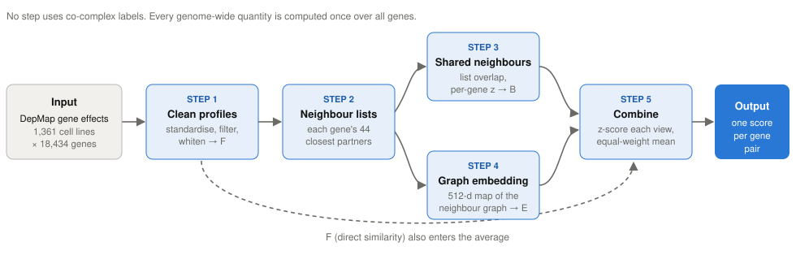

# Predicting protein complexes from shared genetic dependencies

**What it does.** The method (`zavg_BEF`) takes the DepMap CRISPR gene-effect matrix (1,361 cancer cell lines × 18,434 genes) and gives every pair of genes a score that ranks how likely their proteins are subunits of the same complex. It uses no training labels.

**How it differs from the standard approach.** The usual scores ask whether two genes' knockout profiles correlate, either directly (Pearson, Spearman) or after correcting for correlated cell lines (GLS). This method cleans the profiles more carefully, then also asks whether the two genes **share the same co-dependent partners** across the genome, and whether they sit close together in a map of the whole partner network. A direct correlation between two subunits is one noisy number; their shared partners pool evidence from dozens of genes.



**The five steps** (details and the reason for each in [METHOD.md](METHOD.md#steps)):

1. **Clean the profiles.** Put every gene on the same scale, estimate how cell lines co-vary across 17,525 well-measured genes, remove the 20 strongest shared patterns and down-weight the rest (a regularised version of GLS). The correlation of cleaned profiles is **F**.
2. **List partners.** Keep each gene's 44 most similar genes (top 0.25%), after correcting for genes that resemble everything.
3. **Count shared partners.** **B** is the overlap of two genes' partner lists, excluding the pair itself, compared with each gene's typical overlap. This gave the largest gain, mainly for large complexes.
4. **Map the network.** **E** is the similarity of two genes in a 512-dimensional Laplacian eigenmap of the partner network. It helps smaller complexes.
5. **Combine.** Convert B, E and F to z-scores against 200,000 random gene pairs and average them with equal weights.

**Results.** Evaluated on hu.MAP 3.0 training pairs with whole complexes held out (weighted average precision, HT-AP; random scoring ≈ 0.005):

| | Development (5 repeats) | Held-out complexes (one look) |
|---|---|---|
| Pearson | 0.260 | 0.134 |
| Spearman | 0.282 | 0.146 |
| GLS | 0.312 | 0.242 |
| **This method** | **0.470** | **0.345** |

The held-out gain over GLS was +0.103 (95% CI +0.035 to +0.209). The held-out set is small (57 clusters of complexes), and the gain is concentrated in large complexes: averaged complex by complex, the method tied GLS (0.365 vs 0.369). Supervised models trained on the labels did not do better. The official hu.MAP test set has not yet been scored.

**Do not use it** as a calibrated probability, for complexes whose loss does not affect cell growth, for proteins without a DepMap profile, or without checking pairs of genes that sit close together on a chromosome (a known CRISPR artefact that the method slightly amplifies). See [limitations](METHOD.md#limitations).

## The three documents

| Document | What it answers |
|---|---|
| [METHOD.md](METHOD.md) | What the method is and does: steps with reasons, a worked example traced through real data, pseudocode, code locations, results, evidence strength, limitations |
| [JOURNEY.md](JOURNEY.md) | How the AI agents arrived at it: eight turning points, the research process, dead ends |
| [INSIGHTS.md](INSIGHTS.md) | What was learned: scientific, methodological and engineering insights, ranked |

An interactive version of all three is in [`explainer.html`](explainer.html) (one self-contained file: clickable pipeline, step-by-step worked example, expandable timeline).

**Provenance.** This project was run by AI agents (a principal-investigator agent, Claude Opus 5.5, with 25 sub-agents) with minimal human input; no result has yet been verified by a human. Every number in these documents comes from a committed result file or from running the code; sources are cited inline.

## Reproducing the figures and the page

```bash
./.env/bin/python docs/explainer/worked_example.py
```

```bash
./.env/bin/python docs/explainer/make_figures.py
```

```bash
PANDOC=~/anaconda3/bin/pandoc ./.env/bin/python docs/explainer/build_html.py
```

The first needs `datasets/DepMAP/CRISPRGeneEffect.csv` (not distributed; see the repository README) and takes about 11 minutes.
